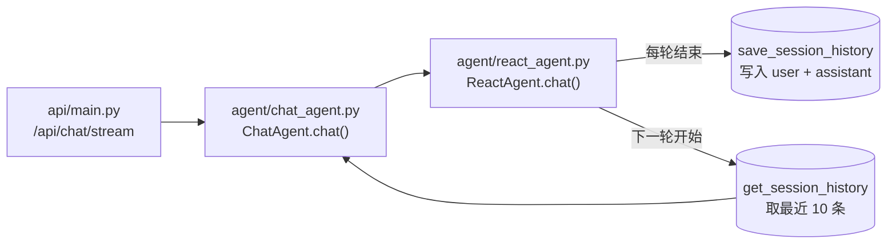

# 完善聊天记录查询功能设计文档

> 目标：为客户提供聊天记录查询体验
> - 同一会话向上滑动可分页加载更早历史（不再有"最多 50 条"的截断）
> - 左侧会话列表，按最近更新时间倒序，支持新建、重命名、删除、置顶
> - 同一会话 ID 下的全部消息可被完整检索

---

## 一、当前实现现状

### 1.1 数据模型

MongoDB 中 `chat_history` 集合采用**单文档承载整个会话**的模式：

```js
{
  _id, session_id, user_id,
  messages: [ {message_id, role, content, timestamp}, ... ],  // 消息内嵌数组
  created_at, updated_at
}
```

索引：`session_id`（唯一）、`{user_id: 1, updated_at: -1}`。

### 1.2 现有方法（utils/mongodb_client.py）

| 方法 | 行为 |
| --- | --- |
| `get_session_history(session_id, limit=10)` | 返回**最新**的 N 条（`messages[-limit:]`） |
| `save_session_history(..., max_history=50)` | `$push + $slice: -50`，**只保留最后 50 条，旧消息永久丢失** |

### 1.3 调用链



每轮对话结束后 `save_session_history` 一次性写入 user + assistant 两条；
下一轮开始时 `get_session_history(limit=10)` 取最近 10 条注入 `chat_history` placeholder。

---

## 二、当前实现缺口

| 目标功能 | 当前实现 | 缺口 |
| --- | --- | --- |
| 同会话向上滑动加载更多 | `$slice: -50` 截断后旧数据已丢失 | **数据丢失 + 无分页能力** |
| 左侧会话列表（按时间倒序） | 有 `{user_id, updated_at:-1}` 索引但无查询接口 | 缺 `GET /api/sessions` |
| 新建会话 | 前端可生成 session_id | 缺显式 `POST /api/sessions` + 标题生成 |
| 会话标题/摘要 | 无字段 | 缺 `title` 字段 + 自动摘要 |
| 删除/重命名会话 | 无接口 | 缺 `PATCH/DELETE` |
| 单条消息定位/删除 | 数组操作 | 内嵌数组维护成本高 |

**最核心的硬伤是 `$slice: -50`**——这会让"向上滑加载历史"功能从根上不可行。需要做架构调整。

---

## 三、推荐架构：拆分 `chat_sessions` + `chat_messages` 两集合

### 3.1 为什么不沿用"单文档 + 大数组"

| 问题 | 影响 |
|---|---|
| MongoDB 文档上限 16MB | 长会话（数千条）会被截断报错 |
| 数组分页只能用 `$slice` 偏移 | 越往后越慢，且无法游标分页 |
| 单条消息删除/编辑需 `$pull` / 数组下标定位 | 复杂、易错 |
| 删除整个会话要删大文档 | 一次删除大批量数据，事务重 |

业界（WeChat / Telegram / 飞书）均采用**会话元信息表 + 消息明细表**两段式。本方案照此改造。

> **本次改造策略**：不保留双写过渡，原有 `chat_history` 集合保持不动（视为遗留），新建 `chat_sessions` 与 `chat_messages` 两集合承担新功能。新集合在 `mongo-init/init.js` 中写好示例数据。

### 3.2 新 Schema

**`chat_sessions` 集合**（仅元信息，每会话一行）

```js
{
  _id,
  session_id: "uuid",            // 唯一
  user_id: "u123",
  title: "贷款咨询-9月2日",       // 自动生成或 LLM 摘要
  last_message_preview: "...",   // 列表页预览（最近一条截断）
  last_message_at: ISODate,
  message_count: 0,              // 冗余计数
  created_at, updated_at,
  pinned: false,                 // 置顶
  archived: false                // 归档
}
```

索引：

- `{session_id: 1}` 唯一
- `{user_id: 1, updated_at: -1}` 列表查询
- `{user_id: 1, pinned: -1, updated_at: -1}` 置顶列表

**`chat_messages` 集合**（每条消息一行）

```js
{
  _id,
  message_id: "uuid",            // 唯一
  session_id: "...",
  user_id: "...",
  role: "user" | "assistant" | "tool" | "system",
  content: "...",
  created_at: ISODate
}
```

索引：

- `{message_id: 1}` 唯一
- `{session_id: 1, created_at: -1}` 主查询路径（向上加载更早）

> 原计划的 `{session_id: 1, created_at: 1}` 反向索引（用于"下拉加载更新"）已废弃——本方案只向上加载更早，向下查看已加载记录由前端本地缓存承担。`init.js` 中该索引保留也无害，可后续清理。

### 3.4 空会话复用策略（防堆叠空会话）

**问题**：用户连续点侧栏"+"按钮，会调多次 `POST /api/sessions`，每次都新建一个 `message_count=0` 的空会话，新对话堆积。

**方案**：`create_session` 加 `reuse_window_minutes` 参数（默认 5），在新建前先查该用户在阈值时间内是否有空会话：

```python
def create_session(self, user_id, agent_mode="react", title=None,
                   reuse_window_minutes=5):
    # 1. 复用窗口内已有空会话 → 直接返回
    if user_id and reuse_window_minutes > 0:
        threshold = now - timedelta(minutes=reuse_window_minutes)
        existing = self._sessions_collection.find_one({
            "user_id": user_id,
            "message_count": 0,
            "created_at": {"$gte": threshold},
        }, sort=[("created_at", -1)])
        if existing:
            return existing   # 复用，不新建
    # 2. 没有可复用的 → 新建
    ...
```

**关键点**：

- `message_count=0` 判断"空会话"。
- 用户发首条消息后 `append_message` 把 `message_count` 累加到 1。
- ChatAgent 兜底路径（裸 UUID）走 `get_session(session_id)` 判"这个 session_id 是否存在"，与"用户是否有空会话"无关，互不干扰。
- `reuse_window_minutes=0` 可关闭复用，退化为"每次都新建"。
- 路由层 `POST /api/sessions?reuse=true|false` 让前端能强制新建（如用户主动想开第二个空会话）。

---

## 四、API 设计

### 4.1 会话列表

```
GET /api/sessions?cursor=&limit=20
→ {
    items: [
      {session_id, title, last_message_preview, last_message_at, message_count, pinned}
    ],
    next_cursor: "base64(updated_at)",
    has_more: true
  }
```

- 按用户维度过滤；游标分页（不用 skip）。
- 排序：置顶 → updated_at 倒序。

### 4.2 新建会话

```
POST /api/sessions?reuse=true|false
（无请求体）
→ { session_id, title, created_at }
```

- 后端生成 `session_id` 和占位标题"新对话 yyyy-MM-dd HH:mm"；**前端不传 title**——新建时尚无对话内容，标题由首条消息后 LLM 异步摘要回填，用户手动改名走 PATCH。
- 用户首条消息后异步触发 LLM 摘要更新 title。
- **`reuse=true`（默认）**：5 分钟内该用户已有 `message_count=0` 的空会话则复用，避免重复点"+"堆叠空会话；用户发首条消息后 `message_count=1`，下次点"+"就正常新建。
- **`reuse=false`**：强制新建，用于"用户主动想开第二个空会话"等场景。
- 阈值 5 分钟可在 `create_session(reuse_window_minutes=N)` 调整；传 0 即关闭复用。

### 4.3 修改 / 删除 / 置顶

```
PATCH   /api/sessions/{session_id}    { title? , pinned?, archived? }
DELETE  /api/sessions/{session_id}    // 同时删 messages
POST    /api/sessions/{session_id}/pin   { pinned: true|false }
```

### 4.4 分页加载历史（核心：向上滑动）

```
GET /api/sessions/{session_id}/messages
    ?cursor=<base64>             // 内含 created_at + message_id
    &limit=30
→ {
    items: [{message_id, role, content, created_at}],
    next_cursor: "...",
    has_more: true
  }
```

> **仅支持向上加载更早**（语义即"before"）。用户向下查看已加载记录无需再请求，前端本地缓存即可。

**游标分页核心查询**（向上加载更早）：

```python
query = {"session_id": session_id}
if cursor:
    cur_created_at, cur_message_id = decode(cursor)
    query["$or"] = [
        {"created_at": {"$lt": cur_created_at}},
        {"created_at": cur_created_at, "message_id": {"$lt": cur_message_id}},
    ]
docs = db.chat_messages.find(query).sort([("created_at", -1), ("message_id", -1)]).limit(limit + 1)
has_more = docs.count() > limit
```

- 首屏：返回最新 N 条（`sort created_at desc limit N`，再反转为升序）。
- 上滑：用当前最顶条目的 `created_at + message_id` 作 cursor，请求更早的一页。
- `next_cursor` 永远指向当前列表最顶（最早）那条，用于下一次上滑。

---

## 五、utils/mongodb_client.py改造点

新增 `_sessions_collection` / `_messages_collection` 字段，并在 `_initialize` 中按环境变量读取集合名。

新增方法：

```python
# ① 会话元信息
def create_session(self, user_id, title=None) -> Dict
def list_sessions(self, user_id, cursor=None, limit=20) -> Dict  # 含 next_cursor
def get_session(self, session_id) -> Optional[Dict]
def rename_session(self, session_id, title) -> bool
def update_session_meta(self, session_id, **fields) -> bool   # pinned/archived/title
def delete_session(self, session_id) -> bool                  # 删 sessions + messages

# ② 消息分页查询
def get_messages_paginated(self, session_id, cursor=None, limit=30) -> Dict
def append_message(self, session_id, user_id, message: Dict) -> bool  # 单条插入 + 更新元信息
def update_session_title(self, session_id, title) -> bool
```

`append_message` 内部用一次性事务同时更新 messages 和 sessions 元信息，并通过 `$setOnInsert` 在会话不存在时自动创建带默认元信息的会话（`user_id` / `title` / `pinned` / `archived` / `created_at`），避免裸 `session_id` 直接发消息时产生缺字段文档导致 `list_sessions` 按 `user_id` 过滤查不到：

```python
with self._client.start_session() as s:
    with s.start_transaction():
        self._messages_collection.insert_one(msg_doc)
        self._sessions_collection.update_one(
            {"session_id": session_id},
            {"$inc": {"message_count": 1},
             "$set": {"last_message_preview": msg["content"][:50],
                      "last_message_at": now, "updated_at": now}},
            upsert=True)
```

> 旧的 `save_session_history` / `get_session_history` **保留不动**，给遗留 `chat_history` 集合使用，避免破坏既有调用。
> 新代码路径走 `append_message` + `get_messages_paginated`。

---

## 六、agent/react_agent.py调用改造（已完成）

- **读路径**：取历史从 `get_session_history(session_id, limit=10)` 切到 `get_messages_paginated(session_id, limit=10)["items"]`。两者都返回最新 N 条且按时间升序，`HumanMessage` / `AIMessage` 构造逻辑不变。
- **写路径**：批量 `save_session_history(...)` 切到两次 `append_message`（先 user 后 assistant，`timestamp` 自然递增）。若会话不存在，`append_message` 的 `upsert + $setOnInsert` 自动创建带默认元信息的会话。

其余 ReAct 主流程（流式事件、工具调用、错误处理）不动。旧的 `save_session_history` / `get_session_history` 及遗留 `chat_history` 集合保留不动，仅作为历史备份。

---

## 七、mongo-init/init.js改造

新增两集合创建 + 索引 + 示例数据：

```js
db.createCollection('chat_sessions');
db.createCollection('chat_messages');

db.chat_sessions.createIndex({ "session_id": 1 }, { unique: true });
db.chat_sessions.createIndex({ "user_id": 1, "updated_at": -1 });
db.chat_sessions.createIndex({ "user_id": 1, "pinned": -1, "updated_at": -1 });

db.chat_messages.createIndex({ "message_id": 1 }, { unique: true });
db.chat_messages.createIndex({ "session_id": 1, "created_at": -1 });
db.chat_messages.createIndex({ "session_id": 1, "created_at": 1 });
```

示例数据：1 个 session + 3 条 message，便于联调分页接口。

---

## 八、前端交互要点

- **首屏**：渲染最新 N=20 条，滚动锚定到底部。
- **向上滑到顶**：拦截 `onReachTop`，拿当前最顶条目的 `created_at + message_id` 作 cursor（即上一页返回的 `next_cursor`）请求更早一页，**前置插入**列表并保持滚动位置不跳动（关键体验，否则会闪到顶）。请求时无需传 `direction`，接口默认就是向上加载更早。
- **向下查看已加载记录**：无需请求，前端本地缓存直接渲染。
- **左侧会话列表**：进入页面调 `GET /api/sessions`；每次 `/chat/stream` 收到 `session_init` 后刷新该会话到列表顶部并更新 `last_message_preview`。
- **新建会话**：调 `POST /api/sessions`（默认 `reuse=true`，5 分钟内已有空会话则复用），把返回的 `session_id` 塞到下一次 `/api/chat/stream` 请求体。前端按钮仍建议加防抖（500ms 禁用），双保险。
- **标题自动摘要**：ChatAgent.chat() 在发消息**之前**查 `get_session` 看 `message_count==0`（首条），标记 `is_first_message=True`；对话完成（SSE 流结束）后 `asyncio.create_task` 异步触发 `TitleGenerator`，调 `deepseek-v4-flash` 把首条用户消息生成 10-15 字标题，回写 `sessions.title`。失败静默保留占位标题。首条消息后 `message_count` 变 2，下次进来不再触发，天然去重。

---

## 九、要点取舍

| 决策 | 建议 |
|---|---|
| 是否做"会话归档/置顶" | 移动端必备，一次性加 `pinned / archived` 字段 |
| 游标用 `message_id` 还是 `created_at` | 复合 cursor = `created_at + message_id`，避免同毫秒并发抖动 |
| 工具调用事件存储 | 当前 ReAct 工具调用未持久化，`chat_messages` 不存 `tool_calls`；未来需要展示 agent 思考过程时再加 |
| 长期记忆 vs 短期记忆边界 | `chat_messages` 是**短期原始流水**；`memory/user_memory.py`是**长期提炼记忆**，二者职责分明，无需合并 |
| 是否双写过渡 | **不做双写**，旧 `chat_history` 集合保持不动视为遗留，新代码直接走新集合 |

### 3.3 会话创建的两条路径

会话的创建有两个入口，最终都走 `mongodb_client.create_session` 这一个方法（单一数据源）：

| 路径 | 触发场景 | 调用方 |
|---|---|---|
| **手动新建** | 用户点侧栏"+"按钮，预先拿到 session_id 再发消息 | 前端调 `POST /api/sessions` |
| **自动兜底** | 用户直接输入消息、没传 session_id（main.py 生成裸 UUID） | `agent/chat_agent.py` 的 `ChatAgent.chat()` 开头 |

**自动兜底的实现**（在 `ChatAgent.chat()` 最开始、记忆注入之前）：

```python
if session_id and user_id and not mongodb_client.get_session(session_id):
    mongodb_client.create_session(user_id=user_id, title=None)
```

- `get_session` 命中（前端已调过 POST）→ 跳过，不重复建。
- 未命中（裸 UUID）→ 显式创建带默认元信息的会话：侧栏立即可见。
- `create_session` 内部已 `try/except`，并发同 session_id 撞唯一索引时返回 None，视作"已存在"忽略；`append_message` 的 `$setOnInsert` 仍兜底。
- 选在 chat 开头而非存历史时：让侧栏在用户发消息瞬间就出现"新对话"（对齐千问/豆包 UX），且对话失败时会话仍作为空草稿保留供重试。

---

## 十、本次落地范围

| 文件 | 函数 / 改动点 | 说明 |
|---|---|---|
| `docs/完善聊天记录查询.md` | — | 本设计文档（现状/差距/两集合方案/API/前端交互/取舍） |
| `utils/mongodb_client.py` | `_encode_cursor` / `_decode_cursor` | base64 编解码 `(created_at, message_id)` 复合游标 |
| | `create_session` | 新建会话；`reuse_window_minutes=5` 复用窗口内空会话 |
| | `get_session` | 按 `session_id` 查单个会话 |
| | `list_sessions` | 按 `user_id` 游标分页列会话（pinned desc + updated_at desc） |
| | `update_session_meta` / `rename_session` / `pin_session` / `archive_session` | 更新会话元信息（title/pinned/archived） |
| | `delete_session` | 事务删除会话 + 该会话下全部消息 |
| | `update_session_title` | LLM 摘要回填 title 专用入口 |
| | `append_message` | 单条消息插入 + 同步更新会话元信息（事务）；`$setOnInsert` 兜底创建会话 |
| | `get_messages_paginated` | 向上加载更早的游标分页查询（无 direction 参数） |
| `mongo-init/init.js` | `chat_sessions` / `chat_messages` 集合 | 新增两集合 + 5 个索引 + 2 会话 3 消息示例数据 |
| `api/models.py` | `SessionUpdate` / `SessionPinRequest` | 会话请求模型（新建会话无请求体，无 Create 模型） |
| | `SessionItem` / `SessionListResponse` | 会话响应模型 |
| | `MessageItem` / `MessageListResponse` | 消息响应模型 |
| `api/session_routes.py` | `POST /api/sessions` | 新建会话，无请求体（`reuse=true` 默认复用空会话；标题后端占位 + LLM 回填） |
| | `GET /api/sessions` | 会话列表游标分页 |
| | `GET /api/sessions/{id}` | 获取单个会话 |
| | `PATCH /api/sessions/{id}` | 更新会话（title/pinned/archived） |
| | `POST /api/sessions/{id}/pin` | 置顶/取消置顶 |
| | `DELETE /api/sessions/{id}` | 删除会话 + 全部消息 |
| `api/message_routes.py` | `GET /api/sessions/{id}/messages` | 消息分页查询，仅向上加载更早，无 `direction` 参数 |
| `api/main.py` | `include_router` | 注册 `session_router` + `message_router` |
| `agent/react_agent.py` | 读路径 | `get_session_history` → `get_messages_paginated(limit=10)` |
| | 写路径 | `save_session_history` → 两次 `append_message`（user + assistant） |
| `agent/chat_agent.py` | `__init__` | `self.mode` 用于决定组装哪条 agent 链（react/plan/reflection），不持久化到会话 |
| | `chat()` 开头 | 会话兜底创建：`get_session` 判空 + `create_session(user_id, title=None)`，裸 UUID 也能自动建会话、侧栏立即可见 |
| | `chat()` 中段 | 判断 `is_first_message`（发消息前查 `message_count==0`） |
| | `chat()` 末尾 + `_generate_session_title` | 首条消息后 `asyncio.create_task` 异步触发 `TitleGenerator` 生成 10-15 字标题，回写 `sessions.title` |
| `memory/title_generator.py` | `TitleGenerator.generate` | 调 `deepseek-v4-flash` 把首条用户消息生成 10-15 字标题；失败返空串；复用 MemoryExtractor 的 OpenAI client 模式 |
| `docs/接口说明/session.md` | — | 7 个接口的完整说明文档（参照 knowledge.md 格式） |
