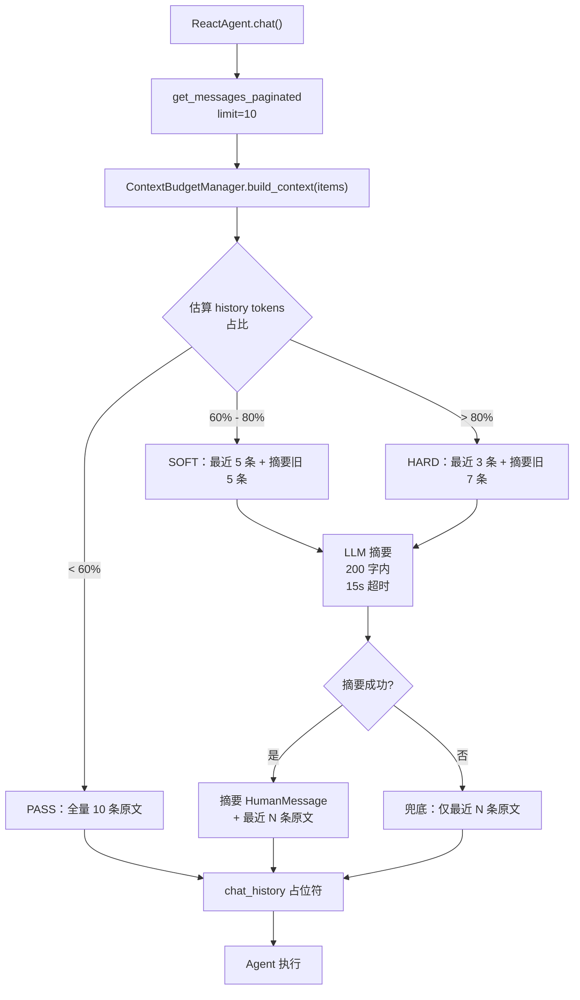

# [功能] 对话上下文 Token 预算控制

> 时间：2026-09-28
> 范围：`agent/react_agent.py`、`utils/context_budget.py`（新增）、`.env` / `.env.example`
> 关联：DeepSeek `deepseek-v4-flash`（64K 上下文窗口）；`chat_messages` 集合分页查询

---

## 一、改造总览

### 1.1 背景

当前 [react_agent.py] 固定从 `chat_messages` 取最新 `limit=10` 条消息注入 `chat_history` 占位符：

```python
history = mongodb_client.get_messages_paginated(session_id, limit=10).get("items", [])
```

固定条数策略在以下场景存在风险：

| 场景 | 风险 |
|---|---|
| 单条消息超长（如贴大段贷款合同、还款计划表） | 10 条即可逼近甚至超出 64K 窗口 |
| 未来扩大 `limit` 至 30-50 提升多轮连贯性 | 累计 token 必然超限，触发 `finish_reason=length`，content 为空 |
| 工具结果回填到 `agent_scratchpad` | 历史占用过高时挤压模型可用输出空间 |

### 1.2 目标

引入 **Token 预算控制 + 实时摘要** 机制：

- 按 token 估算动态判定历史注入策略，不再依赖固定条数。
- 超预算时用 `deepseek-v4-flash` 对旧消息实时生成 200 字内摘要，替换原文注入。
- **不改 `chat_sessions` 表结构**，摘要每次请求实时计算（on-the-fly），不落库。

### 1.3 重构前 vs 重构后

```
[重构前] 固定条数注入
  get_messages_paginated(limit=10)
        │
        ▼
  全部原文 → HumanMessage/AIMessage → chat_history 占位符

[重构后] 预算控制 + 实时摘要
  get_messages_paginated(limit=10)
        │
        ▼
  ContextBudgetManager.build_context(items)
        │
        ├─ 估算 history tokens
        ├─ 占比 < 60%  → 原样注入 10 条
        ├─ 60%-80%     → 最近 5 条原文 + 旧消息 LLM 摘要
        └─ > 80%       → 最近 3 条原文 + 旧消息 LLM 摘要
        │
        ▼
  HumanMessage/AIMessage（混合原文+摘要） → chat_history 占位符
```

---

## 二、设计要点

### 2.1 预算计算

| 项 | 估值 | 说明 |
|---|---|---|
| 模型上下文窗口 | 64,000 tokens | DeepSeek `deepseek-v4-flash` |
| 系统提示词 + 工具 schema | ~8,000 tokens | 五层提示词 + 工具清单 |
| RAG 注入（ChromaDB 记忆） | ~5,000 tokens | ChatAgent `enriched_message` 前缀 |
| 模型响应预留 | ~4,000 tokens | `max_tokens` 保底 |
| **可用历史预算** | **~47,000 tokens** | 64K - 8K - 5K - 4K |

环境变量统一管理：

```
CONTEXT_WINDOW_TOKENS=64000           # 模型上下文窗口
CONTEXT_HISTORY_BUDGET=30000          # 历史注入硬上限（预留 17K 安全垫）
```

> `CONTEXT_HISTORY_BUDGET=30000` 比 47K 更保守，给 `agent_scratchpad`（工具结果）留出空间，避免 ReAct 多轮工具调用时挤压输出。

### 2.2 分层阈值

以 `history_tokens / CONTEXT_HISTORY_BUDGET` 占比分三档：

| 占比 | 策略 | 最近原文保留数 | 旧消息处理 |
|---|---|---|---|
| < 60% | **PASS** | 全部 10 条原文 | 不摘要 |
| 60%-80% | **SOFT** | 5 条原文 | LLM 摘要为 200 字内文字 |
| > 80% | **HARD** | 3 条原文 | LLM 摘要为 200 字内文字 |

摘要注入形态：单条 `HumanMessage`，内容为：

```
[历史对话摘要]
<200 字内摘要>
```

### 2.3 Token 估算

不引入 `tiktoken` 依赖，采用 `len(text) / 3` 粗估（中英混合经验值，中文约 1 字 ≈ 0.5 token，英文约 4 字符 ≈ 1 token，折中取 3）。

```python
def estimate_tokens(text: str) -> int:
    return max(1, len(text) // 3)
```

> 偏保守估算，实际 token 数通常小于估算值，给预算留有正向误差。

### 2.4 摘要生成

使用独立 `AsyncOpenAI` 客户端（与 [title_generator.py]风格一致），延迟初始化：

- **模型**：`deepseek-v4-flash`，`temperature=0.0`
- **prompt**：`请用 200 字以内总结以下对话历史，保留关键事实（用户身份、贷款产品、金额、还款方式、已给建议），不要加入新的信息或观点。`
- **超时**：15 秒（`asyncio.wait_for`，与标题生成一致策略）
- **失败兜底**：摘要返回空串，`build_context` 退化为只注入最近 N 条原文（不阻塞主链路）
- **`max_tokens=1000`**：与 `TitleGenerator` 一致——`deepseek-v4-flash` 是推理模型，思考过程在 `reasoning_content`，`max_tokens` 不足会导致 `finish_reason=length` 且 `content` 为空。仅取 `content`，不取 `reasoning_content`

### 2.5 与 ChromaDB 记忆的边界

| 系统 | 数据来源 | 时间维度 | 注入位置 | 失效策略 |
|---|---|---|---|---|
| **上下文预算控制**（本次） | `chat_messages` 当前会话 | 单会话短期 | `chat_history` 占位符 | 滑动窗口 + LLM 摘要 |
| **ChromaDB 长期记忆** | 跨会话提炼（MemoryExtractor） | 跨会话长期 | `enriched_message` 前缀 | 语义检索 top_k=3 |

两者职责分明，不可互相替代：摘要维持单会话连贯性，ChromaDB 提供用户画像/事实跨会话记忆。理想分工：

```
System Prompt（五层架构）
   +
ChromaDB 相关记忆（enriched_message 前缀）
   +
[历史对话摘要] + 最近 3-5 条原始消息（chat_history 占位符）
   +
当前用户问题（input）
```

---

## 三、详细变更清单

| 文件路径 | 类型 | 作用说明 |
|---|---|---|
| `utils/context_budget.py` | 新增 | `ContextBudgetManager`：token 估算 + 阈值判定 + LLM 摘要 + 消息组装 |
| `agent/react_agent.py` | 修改 | L72-L82 注入逻辑改为调 `ContextBudgetManager.build_context()` |
| `.env` | 修改 | 新增 `CONTEXT_HISTORY_BUDGET=30000`、`CONTEXT_WINDOW_TOKENS=64000` |
| `.env.example` | 修改 | 同步新增配置项及注释 |

### 3.1 `utils/context_budget.py` 关键实现

```python
class ContextBudgetManager:
    """对话上下文 Token 预算控制器。

    按 token 占比分层注入：
      < 60% 原样；60%-80% 最近 5 条+摘要；> 80% 最近 3 条+摘要。
    摘要每次实时生成，不落库。
    """

    SOFT_THRESHOLD = 0.6   # 60%
    HARD_THRESHOLD = 0.8   # 80%
    SOFT_KEEP_RECENT = 5
    HARD_KEEP_RECENT = 3
    PER_MSG_TRUNCATE = 500

    def __init__(self, budget: int = None):
        self._client = None
        self.budget = budget or int(os.getenv("CONTEXT_HISTORY_BUDGET", "30000"))

    @property
    def client(self):
        """延迟初始化 AsyncOpenAI，与 TitleGenerator 风格一致。"""
        if self._client is None:
            self._client = AsyncOpenAI(
                api_key=os.getenv("LLM_API_KEY"),
                base_url=(os.getenv("LLM_BASE_URL", "https://api.deepseek.com")
                          .rstrip("/") + "/v1"),
            )
        return self._client

    @staticmethod
    def estimate_tokens(text: str) -> int:
        return max(1, len(text) // 3)

    async def build_context(self, items: List[Dict]) -> List:
        """入参 items 升序，含 role/content；出参 LangChain Message 列表。"""
        if not items:
            return []
        total = sum(self.estimate_tokens(m.get("content", "")) for m in items)
        ratio = total / self.budget if self.budget > 0 else 0

        # 条数不足或占比未到 SOFT 阈值 → 全量原文
        if ratio < self.SOFT_THRESHOLD or len(items) <= self.SOFT_KEEP_RECENT:
            logger.info(f"history tokens: {total} / {self.budget} ({ratio*100:.1f}%) → PASS")
            return self._to_messages(items)

        keep = self.SOFT_KEEP_RECENT if ratio < self.HARD_THRESHOLD else self.HARD_KEEP_RECENT
        tier = "SOFT" if ratio < self.HARD_THRESHOLD else "HARD"
        recent, old = items[-keep:], items[:-keep]
        logger.info(f"history tokens: {total} / {self.budget} ({ratio*100:.1f}%) → {tier} keep {keep} + summary {len(old)}")

        summary = await self._summarize(old)
        if not summary:
            return self._to_messages(recent)  # 摘要失败兜底
        return [HumanMessage(content=f"[历史对话摘要]\n{summary}")] + self._to_messages(recent)

    async def _summarize(self, old: List[Dict]) -> str:
        if not old:
            return ""
        text = "\n".join(f"[{m.get('role','user')}]: {str(m.get('content',''))[:self.PER_MSG_TRUNCATE]}" for m in old)
        prompt = ("请用 200 字以内总结以下对话历史，保留关键事实"
                  "（用户身份、贷款产品、金额、还款方式、已给建议），"
                  "不要加入新的信息或观点。\n\n" + text)
        try:
            response = await asyncio.wait_for(
                self.client.chat.completions.create(
                    model="deepseek-v4-flash",
                    messages=[{"role": "user", "content": prompt}],
                    temperature=0.0,
                    max_tokens=1000,
                ),
                timeout=15,
            )
            content = (response.choices[0].message.content or "").strip()
            if not content:
                logger.warning("上下文摘要 content 为空")
            return content
        except asyncio.TimeoutError:
            logger.warning("上下文摘要超时（15s），退化为最近 N 条原文")
            return ""
        except Exception as e:
            logger.warning(f"上下文摘要失败: {e}")
            return ""

    @staticmethod
    def _to_messages(items: List[Dict]) -> List:
        msgs = []
        for m in items:
            if m.get("role") == "user":
                msgs.append(HumanMessage(content=m.get("content", "")))
            elif m.get("role") == "assistant":
                msgs.append(AIMessage(content=m.get("content", "")))
        return msgs
```

### 3.2 `agent/react_agent.py` 改造点

L72-L82 原逻辑：

```python
processed_history = []
if session_id:
    history = mongodb_client.get_messages_paginated(session_id, limit=10).get("items", [])
    for msg in history:
        if msg["role"] == "user":
            processed_history.append(HumanMessage(content=msg["content"]))
        elif msg["role"] == "assistant":
            processed_history.append(AIMessage(content=msg["content"]))
```

改为：

```python
processed_history = []
if session_id:
    history = mongodb_client.get_messages_paginated(
        session_id, limit=10
    ).get("items", [])
    budget_mgr = ContextBudgetManager()
    processed_history = await budget_mgr.build_context(history)
```

新增导入：

```python
from utils.context_budget import ContextBudgetManager
```

> `ContextBudgetManager` 内部独立维护 `AsyncOpenAI` 客户端（延迟初始化），与 [title_generator.py]一致，不依赖 ReactAgent 的 `self.llm`，便于独立测试。

---

## 四、配置与依赖

### 4.1 新增环境变量

| 变量名 | 默认值 | 说明 |
|---|---|---|
| `CONTEXT_WINDOW_TOKENS` | `64000` | 模型上下文窗口大小（DeepSeek `deepseek-v4-flash`） |
| `CONTEXT_HISTORY_BUDGET` | `30000` | 历史注入 token 硬上限（含安全垫） |

`.env` / `.env.example` 在 `LLM API 配置` 段后新增：

```
# 对话上下文 Token 预算控制
CONTEXT_WINDOW_TOKENS=64000           # 模型上下文窗口（DeepSeek deepseek-v4-flash）
CONTEXT_HISTORY_BUDGET=30000          # 历史注入 token 硬上限（含安全垫）
```

### 4.2 第三方依赖

无新增。复用现有 `langchain_openai.ChatOpenAI`、`langchain_core.messages`。

---

## 五、测试与验证

### 5.1 单元测试（`test/test_context_budget.py`）

| 场景 | 输入 | 预期 |
|---|---|---|
| PASS 档 | 10 条短消息（总 token < 60% 预算） | 返回 10 条原文 Message |
| SOFT 档 | 10 条长消息（总 token 60%-80%） | 返回 1 条摘要 HumanMessage + 5 条原文 |
| HARD 档 | 10 条超长消息（总 token > 80%） | 返回 1 条摘要 HumanMessage + 3 条原文 |
| 摘要失败 | LLM 调用超时 | 返回最近 N 条原文（不阻塞） |
| 空历史 | `items=[]` | 返回 `[]` |
| 条数不足 | 仅 2 条消息且超预算 | 不触发摘要（`len <= SOFT_KEEP_RECENT` 短路） |

### 5.2 手动验证

启动服务后，构造一段长对话（连续 10+ 轮贷款合同讨论），观察日志：

```bash
# 模拟长对话（前 8 轮注入长文本，第 9 轮触发预算控制）
curl -X POST http://localhost:8000/api/chat/stream \
  -H "Authorization: Bearer <token>" \
  -H "Content-Type: application/json" \
  -d '{"session_id":"<sid>","message":"继续讨论还款计划表..."}'
```

预期日志：

```
INFO  react_agent - history tokens: 28500 / 30000 (95.0%) → HARD 档，保留最近 3 条 + 摘要
INFO  react_agent - 上下文摘要生成成功（187 字）
```

### 5.3 回归验证

- 短对话（< 5 条消息）行为与改造前一致（PASS 档全量原文注入）。
- `chat_messages` 落库数量不变（仅注入侧改变，写库走 `persist_turn` 不变）。
- 标题生成、ChromaDB 记忆注入、WORKFLOW 补录均不受影响。

---

## 六、流程图



---

## 七、注意事项与后续

### 7.1 已知限制

- `len(text) / 3` 为粗估，实际 token 数有 ±20% 误差，但阈值分档有 20% 间隔（60%/80%），不会因误差跨档。
- 摘要为**每次请求实时生成**，不缓存、不落库。同一会话连续对话会重复摘要，有额外 LLM 开销（单次 ~2 秒，可接受）。
- 摘要失败时退化为"最近 N 条原文"，会损失更早的上下文，但不会阻塞主链路。

### 7.2 后续优化方向

| 方向 | 触发条件 | 方案 |
|---|---|---|
| 摘要缓存 | 高频对话重复摘要开销明显 | 在 `chat_sessions` 加 `context_summary` 字段，按 `updated_at` 失效 |
| 精确 token 计算 | 误差导致跨档误判 | 引入 `tiktoken`（`deepseek-v4-flash` 兼容 cl100k_base 编码） |
| 动态 limit | 业务需要更多轮上下文 | `limit` 由预算控制器按剩余 token 反推，而非固定 10 |
| 摘要分级 | 单次摘要仍超长 | 旧摘要 + 新原文再次摘要（递归摘要） |

### 7.3 不做的事

- **不改 `chat_sessions` 表结构**：本次为实时计算方案，无 schema 变更。
- **不引入 `tiktoken`**：避免增加依赖，粗估足够当前场景。
- **不持久化摘要**：会话内摘要与 ChromaDB 跨会话记忆职责分明，不混存。
