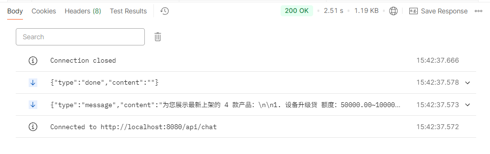

# 聊天接口文档

## 一、对话接口（前端 → Java 网关）

**网址** localhost:8080/api/chat

**请求头**

| 名称 | 值 | 描述 |
| --- | --- | --- |
| Content-Type | application/json | 请求体为 JSON 格式 |
| Authorization | Bearer token | 认证令牌 |

**请求方式** POST（SSE 流式返回）

**请求参数说明**

| 参数名 | 类型 | 描述 | 示例 |
| --- | --- | --- | --- | --- |
| message | string | 用户输入的问题 | "有哪些产品推荐" |
| sessionId | string | 会话ID，初始可以为空 | "" |
| agentMode | string | 智能体范式，默认react，可以不填 | "react" |

**请求示例1（请求体）**

```json
{
  "message": "有哪些产品推荐",
  "sessionId": "",
  "agentMode": "react"
}
```

**路由分发**：Java 端先调 Python `/api/route` 做意图分类：

- `WORKFLOW`（查进度/算月供/列产品/申请贷款）：Java 本地处理，直接 SSE 返回
- `AGENT`（咨询/投诉/兜底）：转发 Python `/api/chat/stream`，由 Agent 链处理

**测试结果**



---

## 二、Agent 对话接口（Java → Python 内部转发）

**网址** localhost:8000/api/chat/stream

由 Java `AgentClientService.forwardToAgent()` 调用，前端不直接访问。SSE 流式返回 Agent 回复。
请求体字段为 snake_case：`message` / `session_id` / `agent_mode`。

对话落库由 Python `ChatAgent` 在流式结束后统一完成（会话兜底创建 → 存用户原话+最终答案 → 首条消息 LLM 标题回填）。

---

## 三、WORKFLOW 对话补录接口（Java → Python 内部回调）

**网址** localhost:8000/api/chat/persist

**背景**：WORKFLOW 请求（查进度/算月供/列产品/申请贷款）在 Java 本地处理，
**不经过** `/api/chat/stream`，Python 端无感知。为保证两条链路的聊天记录完整一致，
Java workflow 处理完成（SSE 已发送）后，由 `AgentClientService.persistWorkflowTurn()`
**异步 fire-and-forget** 回调本接口，把本轮对话补录进 `chat_sessions` / `chat_messages`。

**请求方式** POST

**请求头**

| 名称 | 值 | 描述 |
| --- | --- | --- |
| Content-Type | application/json | |
| Authorization | Bearer token | 透传用户 token，user_id 从 token 解析 |

**请求参数（snake_case）**

| 参数名 | 类型 | 必填 | 描述 |
| --- | --- | --- | --- |
| session_id | string | 是 | 会话ID（与前端一致，不能为空） |
| message | string | 是 | 用户原话 |
| response | string | 是 | workflow 本轮最终回复文本 |

**请求示例**

```json
{
  "session_id": "f0d22921-7cf5-4e41-8f26-8830cbf66c41",
  "message": "我有一笔贷款，10000元，利率0.065，12期，先息后本，每个月应该还多少钱？",
  "response": "计算结果如下：\n\n贷款金额：10000元\n贷款期限：12期\n年利率：6.5%\n还款方式：先息后本\n\n每月还款：54.17元（仅利息）\n到期还本：10000元\n总利息：650元"
}
```

**响应示例**

```json
{
  "code": 200,
  "data": null,
  "message": "对话已持久化"
}
```

**接口内部行为**（与 AGENT 路径共用 `memory/chat_history_service.py`，存储逻辑只有一处）：

1. 会话不存在 → 用 `session_id` 兜底创建（跳过空会话复用）
2. 追加 `user`（用户原话）+ `assistant`（workflow 回复）两条消息
3. 若为会话首条消息（`message_count==0`）→ 调 LLM 生成 10-15 字标题回填
4. 任何失败仅告警，不影响 Java 主链路

**说明**：

- Java 端在 `ChatRouterService.handleWorkflow()` 中触发，SSE 已发送完毕后异步调用，
  补录失败只打 warn 日志，不阻塞、不重试打扰用户
- **session_id 保证非空**：前端首条消息 sessionId 为空时，Java 侧先 `UUID.randomUUID()`
  生成并通过 SSE `session_init` 事件回传前端，再用该 id 补录；仅回复文本为空时跳过
- 长期记忆提取（MemoryExtractor）目前仅在 AGENT 路径触发，WORKFLOW 路径不触发
