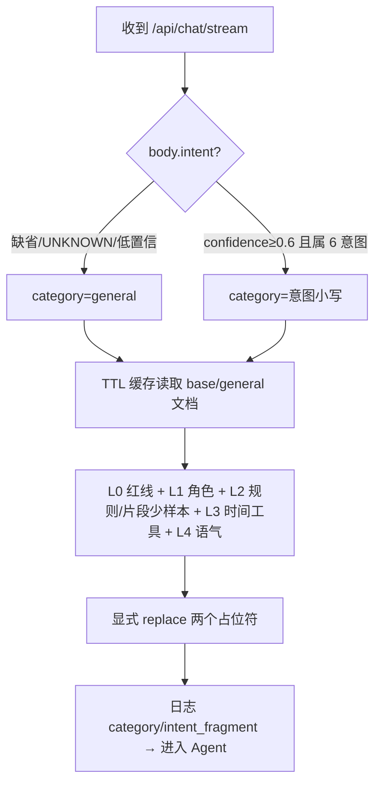

# 提示词精细化 Phase 1 — 五层拆分、意图透传与热更新修复

> 时间：2026-09-22
> 范围：`smart-customer-service`（`agent/`、`api/`、`utils/`、`mongo-init/`）、`project/backend/personal-loan`（Java forward 透传）、`project/frontend`（提示词建档 API 适配）
> 关联：[提示词精细化.md](./提示词精细化.md) 3.1~3.10、[Phase 0 评测基线](./提示词精细化-Phase0-评测基线.md)

## 1. 改造总览

### 1.1 背景与目标

改造前系统提示词是单条 DB 文档，在 `ReactAgent` 构造期经 `str.format` 一次性固化，且 Agent 实例被进程内缓存，导致三个问题：后台改提示词必须重启才生效；DB 内容含 `{` 花括号时 `format` 直接崩溃；所有意图共用一套规则，互相挤占。Phase 1 按方案完成三件事，**不改动 Router、工具与 Plan/Reflection 触发逻辑**（均属 Phase 2）：

1. 单文档拆为五层：L0 合规红线（代码常量）→ L1 角色 → L2 通用规则 + 意图片段 → L3 动态变量 → L4 语气/输出要求；
2. Java 调 `/api/route` 后把 `intent/confidence` 原样透传给 Python，高置信（≥0.6）请求在系统提示词中追加意图专属片段（少样本 + 输出附加要求）；
3. 系统提示词改为**每次请求实时组装**，DB 读取带 60 秒 TTL 缓存，后台增删改激活后主动清缓存，热更新立即生效（最长不超过 60 秒）。

### 1.2 重构前 vs 重构后

```
重构前（单文档 + 构造期固化）                 重构后（五层 + 每次实时组装）
┌───────────────────────────┐               ┌──────────────────────────────────┐
│ MongoDB prompts           │               │ L0 SECURITY_RULES（代码常量）      │
│  default_prompt           │               │ L1 base.role_definition          │
│  category=loan_customer_  │   每次chat    │ L2 general 通用规则               │
│  service（唯一文档）       │ ───────────▶  │    + 意图专属片段（门槛≥0.6）      │
│  role/rules/tone 混在一起  │   实时组装    │ L3 当前时间 / 工具清单（运行时）   │
└─────────────┬─────────────┘               │ L4 base.tone + 片段 output_extra │
              │ __init__ 时 .format 一次     └──────────────┬───────────────────┘
              ▼  Agent 实例被 _agent_cache 缓存             │ 每次 chat 重新组装
   改提示词须重启；DB 花括号 → 崩溃             改后≤60s 生效；花括号原样保留不崩
```

### 1.3 意图透传链路

```
前端 → Java ChatController.chat()
        ├─ POST Python /api/route → RouteResult{intent, confidence, action}
        ├─ WORKFLOW：Java 本地 Handler（不变）
        └─ AGENT：AgentClientService.forwardToAgent(..., intent, confidence)
                    POST /api/chat/stream body 新增 intent/confidence（缺省可不传）
                      → main.py 取出透传
                        → get_chat_agent(mode).chat(..., intent, confidence)
                          → ReactAgent/PlanExecute/Reflection 逐层透传
                            → get_system_prompt(intent, confidence, tools)
                              → resolve_category()：唯一门槛宿主
```

## 2. 详细变更清单

### 2.1 文件清单

| 文件路径 | 类型 | 作用说明 |
|---|---|---|
| `smart-customer-service/agent/prompts.py` | 重写 | 五层组装核心：常量 `BASE_CATEGORY`/`GENERAL_CATEGORY`/`INTENT_PROMPT_THRESHOLD=0.6`/`PROMPT_CACHE_TTL=60`/`INTENT_CATEGORIES`；扩充 `SECURITY_RULES`；`resolve_category()`、`get_system_prompt()`、TTL 缓存与 `invalidate_prompt_cache()`、内置默认值兜底、少样本渲染 |
| `smart-customer-service/agent/react_agent.py` | 修改 | 删除构造期提示词固化；`chat()` 新增 `intent/confidence` 参数，每次请求实时组装并传入当前工具清单 |
| `smart-customer-service/agent/base_agent.py` | 修改 | 抽象 `chat` 签名增加 `intent/confidence` |
| `smart-customer-service/agent/chat_agent.py` | 修改 | 工厂入口签名与内层调用透传两字段 |
| `smart-customer-service/agent/plan_execute_agent.py` | 修改 | 3 处 `inner.chat` 透传两字段 |
| `smart-customer-service/agent/reflection_agent.py` | 修改 | 2 处 `inner.chat` 透传；意图优先触发仍保留关键词判断（Phase 2 再改） |
| `smart-customer-service/api/models.py` | 修改 | `ChatRequest` 增加 `intent`/`confidence`（0~1 校验）；新增 `FewShot`、`PromptCreate`；`PromptContent` 字段全部 Optional 并增加 `few_shots`/`output_extra`；新增 `PromptContentUpdate` |
| `smart-customer-service/api/main.py` | 修改 | `/api/chat/stream` 从 body 取两字段（None→1.0）透传给 Agent，日志记录 intent/confidence |
| `smart-customer-service/api/prompt_routes.py` | 修改 | POST 改为 JSON body（`PromptCreate`）+ category 白名单 + 同 category 版本自增；`GET /active` 增加 `category` 查询参数（默认 base）；update/activate/deactivate/delete 后清组装缓存 |
| `smart-customer-service/api/seed_prompts.py` | 新增 | 幂等迁移播种脚本：旧 category → base；按稳定 prompt_id 播种 general + 6 意图片段，已存在不覆盖 |
| `smart-customer-service/utils/mongodb_client.py` | 修改 | `get_active_prompt(category="base")` 默认值由旧分类改为 base；激活互斥停用兜底分类同步改 base |
| `smart-customer-service/mongo-init/init.js` | 修改 | 全新部署种子替换为 8 份文档（base + general + 6 意图），结构与 seed 脚本一致 |
| `smart-customer-service/test/test_prompt_management.py` | 修改 | 删除对已移除函数 `get_prompt_config` 的失效导入 |
| `project/backend/.../service/AgentClientService.java` | 修改 | `forwardToAgent` 签名增加 `String intent, Double confidence`；出站请求体由 `Map.of` 改 `HashMap`，仅在非空时放入两字段 |
| `project/backend/.../controller/ChatController.java` | 修改 | AGENT 分支把 `route.getIntent().name()` 与 `route.getConfidence()` 原样传入 forward（Java 不做门槛判断） |
| `project/frontend/src/api/modules/prompts.js` | 修改 | 建档由 query 参数改为 JSON body（name/category/version/content） |

### 2.2 关键实现

**门槛唯一宿主**（`agent/prompts.py`）：

```python
INTENT_PROMPT_THRESHOLD = 0.6
INTENT_CATEGORIES = {"query_status", "calculate", "list_products",
                     "apply_loan", "complaint", "consult"}

def resolve_category(intent, confidence):
    # 缺省 / UNKNOWN / 低置信 / 无法识别 → general（行为同改造前）
    if intent and confidence is not None and confidence >= INTENT_PROMPT_THRESHOLD:
        category = intent.strip().lower()
        if category in INTENT_CATEGORIES:
            return category
    return GENERAL_CATEGORY
```

**热更新 + 花括号安全**：DB 读取走 TTL 缓存；占位符只做两个已知 token 的显式 `.replace()`，不用 `str.format`，DB 内容里的任意花括号原样保留。后台写操作调 `invalidate_prompt_cache()` 立即生效。

```python
final_prompt = template.replace("{current_date}", current_date) \
                       .replace("{tools_description}", tools_description)
```

**片段内容结构**：意图片段只承载本意图特有规则（`business_rules` ≤300 字，措辞用"可能"）、1~2 条 `few_shots`（input/expect）、可选 `output_extra`；通用规则始终来自 `general`，片段不重复通用规则。当前 6 个意图片段：query_status / calculate / list_products / apply_loan / complaint / consult。

**Java 透传**（`AgentClientService.java`）：

```java
if (intent != null) request.put("intent", intent);
if (confidence != null) request.put("confidence", confidence);
```

## 3. 配置与依赖

- 新增环境变量：**无**。
- 新增第三方依赖：**无**（Python、Java、前端均使用现有库）。
- 数据变更：MongoDB `prompts` 集合由 1 条变为 8 条（base/general/6 意图，同 category 激活互斥由 `update_prompt` 保证）。存量库执行 `api.seed_prompts`；全新部署由 `mongo-init/init.js` 自动播种。
- 兼容性：`/api/chat/stream` 的 `intent/confidence` 均可缺省，缺省即 general，与改造前行为一致；Java ChatRequest 入站 DTO 无变化。

## 4. 测试与验证

### 4.1 静态检查

```powershell
cd smart-customer-service
.\.venv\Scripts\python.exe -m py_compile agent/prompts.py agent/react_agent.py agent/chat_agent.py `
  agent/plan_execute_agent.py agent/reflection_agent.py agent/base_agent.py api/models.py `
  api/main.py api/prompt_routes.py api/seed_prompts.py utils/mongodb_client.py
```

Java 侧：`.\mvnw.cmd compile -DskipTests` → `BUILD SUCCESS`。

### 4.2 离线评测回归（对照 Phase 0 基线）

```powershell
$env:PYTHONIOENCODING="utf-8"
.\.venv\Scripts\python.exe test/benchmark_prompt.py --groups route,tool,answer
```

| 指标 | Phase 0 基线 | Phase 1 首跑 | Phase 1 重跑（排除单次随机） |
|---|---|---|---|
| route 意图准确率 | 93.3% | 91.7% | **95.0%** |
| route 分流正确率 | 97.4% | 100% | **100%** |
| tool 命中率（执行 12 / skip 8） | 100% | 91.7%（1 条 LLM 网络错误） | **100%**，误用 0 |
| answer 通过率 | 85% | **100%** | — |
| answer 平均要点覆盖 | 90% | **96.7%** | — |
| 禁词违规 | 0 | **0** | **0** |

报告文件：首跑 `test/benchmark_results/prompt_eval_report_20260922_212752.json`、重跑 `test/benchmark_results/prompt_eval_report_20260922_213939.json`。

说明：Router 代码 Phase 1 未改动，首跑新增误判（route_008/018/026）全部自报 confidence=0.50，门槛下回落 general，线上行为与改造前一致；route_026/040/057 在基线中同样失败，属 Router 少样本优化（Phase 2）范畴。temperature=0.7 下重跑波动用例不重叠，route/tool 均回到或超过基线。

### 4.3 端到端验收（5 条标准实测）

服务以 `.venv` Python 启动（`python -m uvicorn api.main:app --port 8000`）后，经真实 HTTP `/api/chat/stream` 验证：

1. **热更新≤1 分钟生效**：PUT 给 complaint 激活片段追加规则"回复第一句必须是『热更已生效』"，不重启立即发起 COMPLAINT(0.92) 对话，回复首句即为"热更已生效"；验证后已还原原文。
2. **DB 含花括号不崩**：函数级注入 `{"a": 1}`、`{broken}`、`{x` 组装正常；管理 API POST 含花括号片段返回 201，删除正常。
3. **高置信意图日志见专属片段**：

   ```
   系统提示词组装: category=calculate intent=CALCULATE confidence=0.95 intent_fragment=有
   系统提示词组装: category=complaint intent=COMPLAINT confidence=0.92 intent_fragment=有
   ```
4. **intent/confidence 缺省行为不变**：不传两字段时日志为 `category=general intent=None confidence=1.0 intent_fragment=无`；低置信（0.5）经 `resolve_category` 单测同样回落 general。
5. **评测指标不低于基线**：见 4.2，重跑 route 95.0%、tool 100%，answer 首跑 100%，禁词 0。

另验证：建档 category 白名单对非法值返回 HTTP 400；迁移/播种脚本重复执行幂等（base 按 category 判重，片段按稳定 prompt_id 判重）。

## 5. 流程图：单次对话的提示词组装



## 6. 注意事项与后续

- **门槛初值 0.6** 为代码常量 `INTENT_PROMPT_THRESHOLD`，调整需改代码；置信度校准表见 Phase 0 报告。
- 缓存为**进程内**缓存，多副本部署时后台写操作只清本副本，其他副本靠 60 秒 TTL 自然过期；后续如需多副本强一致可改 Redis  pub/sub。
- `general` 片段缺失时依次回退 base.business_rules、内置默认；任一 category 的 DB 文档读取异常均不影响对话，组装函数与主路径共用同一套兜底。
- PUT 接口沿用"空字符串=不修改"约定，清空 `output_extra` 当前需直接操作 DB 或删除字段后重激活；后台未提供专门清空入口。
- Reflection 的意图优先触发仍为关键词判断，刻意推迟到 Phase 2；本阶段仅完成参数透传。
- Phase 2 待办（本次均未触碰）：Router few-shot/reason/max_tokens、工具描述四要素与按意图工具权限表（`get_system_prompt(tools=...)` 已预留入口）、Plan 工具清单、Reflection 六维评估与 severity、灰度开关。
