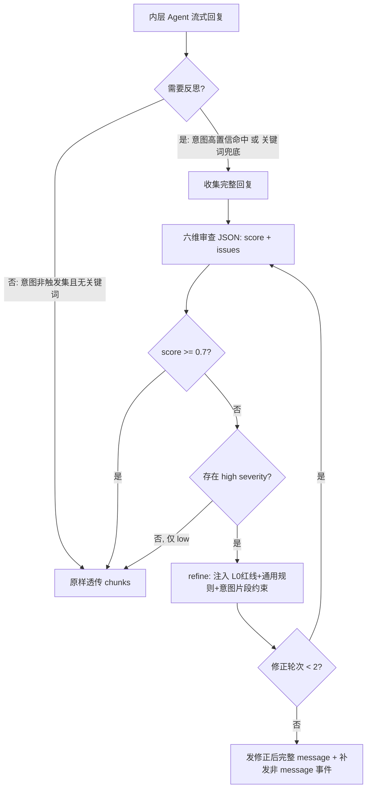

# 提示词精细化 Phase 2 — Router 增强、工具描述四要素与 Plan/Reflection 规范化

> 时间：2026-09-23
> 范围：`smart-customer-service`（`api/route_routes.py`、`api/models.py`、`tools/search_tools.py`、`agent/plan_execute_agent.py`、`agent/reflection_agent.py`、`agent/prompts.py`、`test/benchmark_prompt.py`）
> 关联：[提示词精细化.md](./提示词精细化.md) 3.5/3.6/3.7/3.8 与 Phase 2 路线表、[Phase 0 评测基线](./提示词精细化-Phase0-评测基线.md)、[Phase 1 五层拆分与意图透传](./提示词精细化-Phase1-五层拆分与意图透传.md)

## 1. 改造总览

### 1.1 背景与目标

Phase 1 完成提示词五层拆分与意图透传后，链路上还剩四个提示词薄弱点：Router 无边界 few-shot、无判断依据且 `max_tokens=100`；两个搜索工具只有一句话描述；Plan 步骤可能落到不存在的工具上；Reflection 触发只靠关键词、审查维度粗、所有问题都可能触发重写。Phase 2 按方案完成四项改造，**不改变任何对外接口语义（`reason` 为可选字段）、不 JSON 化 Plan 输出协议、不改单一权威工具调用协议**：

1. **Router 增强**：8 条边界 few-shot（多轮 messages 注入）+ 输出一句话 `reason` + `max_tokens` 100→200 + 逐字命中示例的入口短路 + 空返回剥示例重试；
2. **工具描述四要素**：`search_web`/`search_knowledge` docstring 改为「做什么 / 何时用 / 何时不用（负边界）/ 失败处理」+ Args 说明；
3. **Plan 输入侧规范化**：规划 prompt 注入当前可用工具清单（名称 + 首行能力），步骤必须动词开头并落到具体工具，禁止"查征信"类无工具步骤；输出仍为按行文本；
4. **Reflection 规范化**：触发改为「透传意图优先（CALCULATE/APPLY_LOAN/CONSULT 且置信度达门槛）+ 关键词兜底」；审查扩为六维（新增引用忠实度、合规性）并打 high/low 严重度；**仅 `score<0.7` 且存在 high 问题才 refine**；refine 注入 L0 红线 + 通用规则 + 当前意图片段约束。

### 1.2 重构前 vs 重构后

```
重构前                                          重构后
┌───────────────────────────┐                 ┌────────────────────────────────────┐
│ Router                    │                 │ Router                             │
│  无 few-shot              │                 │  8 条边界 few-shot（措辞独立于评测集）│
│  输出 intent/confidence   │ ─────────────▶  │  输出 reason/intent/confidence      │
│  max_tokens=100 易截断    │                 │  max_tokens=200；空返回剥示例重试    │
├───────────────────────────┤                 ├────────────────────────────────────┤
│ 工具描述：一句话 docstring │                 │ 四要素：做什么/何时用/何时不用/失败处理│
├───────────────────────────┤                 ├────────────────────────────────────┤
│ Plan：无工具清单，可能出现  │                 │ Plan：注入实时工具清单+步骤格式约束  │
│ "查询征信"等无工具步骤     │                 │      （输出协议仍为按行文本）         │
├───────────────────────────┤                 ├────────────────────────────────────┤
│ Reflection：关键词触发     │                 │ Reflection：意图优先触发+关键词兜底  │
│ 粗粒度审查，问题即重写     │                 │ 六维审查+severity，仅 high 且低分重写│
└───────────────────────────┘                 └────────────────────────────────────┘
```

### 1.3 阈值校准结论

`agent/prompts.py` 中意图特化透传门槛 `INTENT_PROMPT_THRESHOLD` **0.6 → 0.5**。依据：60 条 route 集上自报 0.5~0.6 段实测准确率 87.5%（n=16），达到方案 3.6 设定的 75~80% 下移条件；0.5 同时是 Router 解析失败的兜底置信度，兜底意图本就是 CONSULT，特化方向一致。分流阈值 `CONFIDENCE_THRESHOLD=0.8` 不动（≥0.8 段两轮实测均 100%）。

## 2. 详细变更清单

### 2.1 文件清单

| 文件路径 | 类型 | 作用说明 |
|---|---|---|
| `smart-customer-service/api/models.py` | 修改 | `RouteResult` 增加 `reason: Optional[str] = None`（一句话分类依据，仅追溯用，不参与分流；向后兼容） |
| `smart-customer-service/api/route_routes.py` | 修改 | 新增 `ROUTER_FEWSHOTS`（8 条边界对，user+assistant JSON 多轮注入，措辞与 eval_cases.json 不同句）与 `_FEWSHOT_LOOKUP` 精确匹配表；入口短路：输入 strip 后逐字命中示例文本时不调 LLM 直接返回人工标注答案（规避"逐字重复触发空 content"，实测命中延迟 3ms）；system prompt 增加边界区分规则与 reason 字段要求；`max_tokens` 100→200；`_parse_response` 返回 `(intent, confidence, reason)` 三元组并容错旧字符串格式；空 content 时剥离 few-shot 仅留 system+真实消息重试一次（兜其他未知原因）；路由日志带 reason |
| `smart-customer-service/tools/search_tools.py` | 修改 | `search_web`、`search_knowledge` docstring 改四要素（做什么/何时用/何时不用负边界/失败处理）并补 Args 参数说明；函数行为不变 |
| `smart-customer-service/agent/plan_execute_agent.py` | 修改 | import `tool_manager`；新增 `_render_available_tools()`（取每个工具 description 首行）；`_create_plan(message, tools_description)` 注入工具清单与步骤格式约束；LLM 预算 300→2000 首调、空/截断加量 3000 重试（见 7.3） |
| `smart-customer-service/agent/prompts.py` | 修改 | `INTENT_PROMPT_THRESHOLD` 0.6→0.5（含校准注释）；新增 `get_refinement_constraints(intent, confidence)`，返回 L0 `SECURITY_RULES` + general 业务规则 + 当前意图片段规则，供 Reflection refine 注入 |
| `smart-customer-service/agent/reflection_agent.py` | 重写 | 意图优先触发 + 关键词兜底；六维审查返回 `(score, issues[{dim,desc,severity}])`；双闸门（`score<0.7` 且有 high）才 refine，low 放行；refine 带约束、temperature=0.3；未修正原样透传保持流式，修正后先发完整 message 再补发非 message 事件；审查/修正 LLM 预算加大并带解析容错重试（见 7.3） |
| `smart-customer-service/test/benchmark_prompt.py` | 修改 | 新增 `--intent-source {none,route}`：route 模式每条 tool/answer 用例先调真实 `/api/route` 取 intent/confidence 透传给 `agent.chat()`；detail 记录 `routed_intent`/`routed_confidence`/`prompt_category`；汇总新增 `intent_passthrough`（特化数/率/category 分布），tool/answer 两段均输出 |

### 2.2 关键实现

**Router few-shot 与输出协议**（`api/route_routes.py`）：8 条示例覆盖四组易混边界——查自己进度 vs 咨询政策、要具体数字 vs 问计息规则、要产品列表 vs 要选择建议、求助 vs 投诉。assistant 回合为纯 JSON：

```json
{"reason": "问自己那笔申请的审批结果，是查进度", "intent": "QUERY_STATUS", "confidence": 0.95}
```

**Reflection 触发与修正双闸门**（`agent/reflection_agent.py`）：

```python
INTENT_TRIGGER = {"CALCULATE", "APPLY_LOAN", "CONSULT"}
SCORE_THRESHOLD = 0.7
# 触发：透传意图在集合内且 confidence >= INTENT_PROMPT_THRESHOLD(0.5)，否则关键词兜底
# 修正：score < 0.7 且 issues 中存在 severity == "high"，二者同时满足才 refine
# low severity（补充/建议/措辞/格式类）即使分数不高也放行，最多修正 2 轮
```

六维：数字准确性 / 事实忠实 / 引用忠实度 / 合规性 / 逻辑完整 / 表达恰当。issues 同时兼容对象数组与模型常返回的字符串数组（字符串按关键词映射严重度，默认 high）。

**Plan 工具约束**（`agent/plan_execute_agent.py`）：

```
可用工具（每一步必须能由这些工具完成，或基于对话中已有的信息直接作答）:
- `search_web`：搜索互联网获取实时外部信息……
- `search_knowledge`：在贷款知识库中检索权威信息……
步骤要求:
- 每步以动词开头，并明确落到上面某个具体工具
- 禁止规划没有工具支撑的步骤（如"查询用户征信""联系风控部门"）
```

**Refine 约束注入**（`agent/prompts.py:get_refinement_constraints`）：修正回复时携带「安全与合规红线（最高优先级）+ 通用业务规则 + 当前意图片段规则」，要求修正不得引入新违规、保留正确内容、只输出回复正文。

## 3. 配置与依赖

- 新增环境变量：**无**。
- 新增第三方依赖：**无**。
- 模型与温度不变：`deepseek-v4-flash`；Router temperature=0.0；refine temperature=0.3。
- LLM 调用预算调整（`max_tokens`）：Router 100→200；Plan 300→2000（失败加量 3000）；Reflection 审查 400→2000（解析失败 3000 重试）、修正 1000→2000。原因见 7.3。

## 4. 测试与验证

### 4.1 自动化回归（真实 HTTP 接口，react 模式）

命令（PowerShell，需先设 `$env:PYTHONIOENCODING="utf-8"`，服务在 8000 端口）：

```powershell
.\.venv\Scripts\python.exe test/benchmark_prompt.py --groups route
.\.venv\Scripts\python.exe test/benchmark_prompt.py --groups tool,answer --intent-source route
```

**route 组（两轮对照，temperature=0 仍有抖动，按方案不凭单轮下结论）**

| 报告 | 意图准确率 | 分流正确率 | 边界组 | 对抗组 | easy |
|---|---|---|---|---|---|
| Phase 0 基线（2026-09-22） | 93.3%（56/60） | 97.4%（37/38） | 90% | 89% | 97% |
| Phase 2 第 1 轮 `prompt_eval_report_20260923_210035.json` | **96.7%**（58/60） | **100%**（38/38） | 90.5% | 100% | 100% |
| Phase 2 第 2 轮（门槛 0.5 后）`prompt_eval_report_20260923_211151.json` | **93.3%**（56/60） | **100%**（38/38） | 85.7% | 88.9% | 100% |

- 两轮均值 95.0% ≥ 基线 93.3%；分流正确率两轮均 100% ≥ 基线 97.4%。
- 第 1 轮 2 个失败：route_018、route_026（均自报 0.5 的边界句）。
- 第 2 轮 4 个失败：route_007、route_008（QUERY_STATUS 边界，均误判 CONSULT）、route_041（费用争议→应为 COMPLAINT）、route_057（多意图混杂对抗句），4 条自报置信度均为 0.5；其中 route_007、route_057 在 Phase 0 基线同样判错。

**置信度校准表（自报分段 → 该段实际准确率）**

| 分段 | 第 1 轮（门槛 0.6） | 第 2 轮（门槛 0.5） |
|---|---|---|
| 0.5-0.6 | n=16，87.5% | n=12，66.7% |
| 0.7-0.8 | n=1，100% | n=1，100% |
| 0.8-0.9 | n=3，100% | n=3，100% |
| 0.9-1.0 | n=40，100% | n=43，100% |

≥0.7 各段两轮全部 100%；0.5-0.6 段样本在两轮间整体迁移且准确率波动（87.5% vs 66.7%），结论与限制见 7.2。

**tool + answer 组（`--intent-source route`，复刻生产链路）**

报告：`test/benchmark_results/prompt_eval_report_20260923_212209.json`

| 指标 | Phase 0 基线 | Phase 2 | 判定 |
|---|---|---|---|
| tool 命中率 | 100%（12 跑 / 8 skip） | **100%**（12 跑 / 8 skip） | 不回退 |
| tool 误调用 | 0 | **0** | 不升 |
| tool 意图片段特化率 | — | 12/12 = **100%**（均 consult；skip 用例期望工具为 `calculate_repayment`/`query_application_status`，MCP 工具集为空未加载） | — |
| answer 通过率 | 85%（17/20） | **95%**（19/20） | 提升 |
| answer 平均要点覆盖率 | 90% | **95.84%** | 提升 |
| answer 禁词违规 | 0 | **0** | 硬门禁守住 |
| answer 意图片段特化率 | — | 20/20 = **100%**（consult 18 / calculate 1 / list_products 1） | — |

唯一失败 answer_002（覆盖率 0.5，命中"收入"未命中字面"征信"，回复实际表述为"信用记录良好"）：关键词判定方式的已知局限，Phase 0 基线同一条用例也失败。

### 4.2 Reflection / Plan 专项实测

评测集走 react 模式不经过 Reflection，另以临时脚本做进程内实测（脚本验完已删除），结果：

| 场景 | 结果 |
|---|---|
| 触发判断 7 例（高置信任意图、COMPLAINT/QUERY_STATUS 高置信不触发、意图缺失关键词兜底、低置信关键词兜底） | 7/7 符合预期 |
| 六维审查违规回复（"保证放款/100%下款/审核必过" + 心算月供 + 编造产品名） | score 0.05~0.15，6 条 high（覆盖合规性×2、事实忠实、数字准确性、引用忠实度、表达恰当） |
| 上述回复 refine 后 | 禁词命中 **0**，改为"不能承诺放款或审批结果……以系统实际审批通知为准"，并要求先确认年化利率与还款方式再测算 |
| 合规回复审查 | score 0.8（1 条 low）/ 1.0（0 问题）→ 不修正直接放行 |
| 端到端（ReflectionAgent 包 ReactAgent，CONSULT 0.9："还款方式有哪几种"） | 正常调用 `search_knowledge`，回复 521 字，0 次修正，无禁词 |
| Plan 规划（"提前还款规则 + 等额本息/本金对比"） | 4 步全部锚定 `search_knowledge`；无"征信/风控部门"类虚步；简单问"利率多少"产出 3 步（知识库→联网→整合） |

### 4.3 接口冒烟

`POST /api/route`（最终代码服务）实际返回（reason 为新增字段）：

```json
{"intent": "QUERY_STATUS", "confidence": 0.96, "action": "WORKFLOW", "reason": "问自己那笔贷款的审批进度，是查状态"}
```

## 5. Reflection 审查—修正流程



## 6. 注意事项与后续

1. **few-shot 不得回写成评测集原句**：`ROUTER_FEWSHOTS` 的措辞刻意与 `test/eval_cases.json` 不同句。实测当真实输入与 few-shot 轮逐字相同时，该模型在 `json_object` 下会返回空 content（既造成测试泄漏又触发空返回）。防御为双保险：入口对逐字命中的输入短路返回标注答案（不调 LLM），其余未知原因的空返回由"剥示例重试"兜底；示例文案必须保持独立。
2. **0.5-0.6 置信段不稳定**：两轮校准该段准确率 87.5% 与 66.7%，样本会随边界判定整体迁移；门槛已按方案规则下移到 0.5，但该段的稳定性需后续扩大样本再评，`SCORE_THRESHOLD=0.7` 与分流阈值 0.8 本期均不调。
3. **模型隐式推理链占用输出预算**：`deepseek-v4-flash` 经网关返回 `reasoning_content`，审查/规划类任务推理较长时，`max_tokens` 不足会出现 `finish_reason=length` 且 `content` 为空（400/600/1200 均复现过）。Phase 2 已上调预算并对空/截断结果加量重试（Plan 2000→3000；审查 2000→3000）；后续若更换无隐式推理的模型可回收这部分预算。
4. **Reflection 的流式代价**：未触发修正时事件原样透传，流式体感不变；一旦修正，回复变为"完整文本一次性发出 + 补发工具事件"，首字延迟等于整轮生成 + 审查 + 修正耗时。reflection 过程事件透出前端属 Phase 3，本期不做。
5. **skip 用例口径**：tool 组 8 条 skip 与基线完全一致，原因是当前 MCP 工具集合为空，`calculate_repayment`、`query_application_status` 未加载；不纳入命中率。
6. **向后兼容**：`reason` 缺省为 `null`，旧消费方无感知；`intent/confidence` 缺省时 Reflection 退回关键词触发、Router 解析失败兜底 CONSULT/0.5，行为与改造前一致。
7. **Phase 3 未启动**：灰度 rollout、前端意图片段编辑、SSE 过程事件透出、LLM-as-judge 均未触碰。
